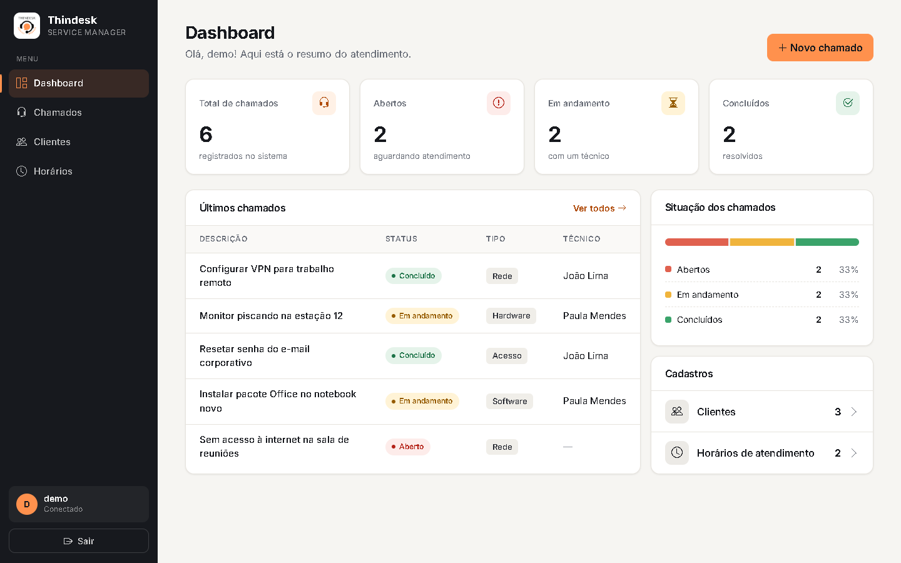

# Thindesk

Sistema web de controle de chamados técnicos (help desk), desenvolvido em Java com Spring Boot e MongoDB.


## Acesso online

- **Aplicação:** https://thindesk-gldv.onrender.com
- **Como entrar:** acesse o link, clique em **Criar conta**, cadastre um usuário e faça login.

> A hospedagem gratuita pode "dormir" quando fica sem uso. O primeiro acesso pode levar até 1 minuto.

## Dashboard



## Funcionalidades

- **Dashboard** com indicadores de chamados (total, abertos, em andamento, concluídos), clientes, horários e últimos chamados
- **Chamados**: abrir, editar (status, tipo, técnico, solicitante) e excluir
- **Clientes**: cadastrar, editar e excluir
- **Horários de atendimento** por setor e dia da semana, com validação de horário
- Login com usuários cadastrados no MongoDB (senhas armazenadas com hash BCrypt)
- Cadastro de novos usuários
- Proteção contra CSRF em todos os formulários

## Tecnologias

| Camada | Tecnologia |
|---|---|
| Linguagem | Java 21 |
| Framework | Spring Boot 3.4 (Web, Security, Data MongoDB) |
| Interface | Thymeleaf + Bootstrap 5 |
| Banco de dados | MongoDB Atlas |
| Build | Maven (wrapper incluso) |
| Deploy | Docker no Render (plano gratuito) |

## Como rodar localmente

### Pré-requisitos

- JDK 21
- Um banco MongoDB (por exemplo, um cluster gratuito no [MongoDB Atlas](https://www.mongodb.com/cloud/atlas))

### Configuração

As credenciais **não** ficam no código. A aplicação lê as variáveis de ambiente abaixo:

| Variável | Obrigatória | Descrição |
|---|---|---|
| `MONGODB_URI` | Sim | URI de conexão do MongoDB |
| `MONGODB_DATABASE` | Não | Nome do banco (padrão: `thindesk`; recomenda-se `thindesk_dev` no desenvolvimento) |
| `PORT` | Não | Porta HTTP (padrão: `8080`) |
| `THYMELEAF_CACHE` | Não | Cache de templates (padrão: `false`; use `true` em produção) |

Para desenvolvimento, copie o arquivo de exemplo e preencha com seus dados (o `.env` é ignorado pelo Git):

```bash
cp .env.example .env
```

### Execução

```bash
# Windows
mvnw.cmd spring-boot:run

# Linux / macOS
./mvnw spring-boot:run
```

Acesse `http://localhost:8080`.

### Gerar o pacote

```bash
./mvnw clean package
java -jar target/thindesk-1.0.0.jar
```

## Deploy

A aplicação publicada roda no [Render](https://render.com) (plano gratuito), em um contêiner Docker:

1. O `Dockerfile` compila o projeto com Maven e gera uma imagem enxuta, só com o JRE 21 e o `.jar`.
2. O `render.yaml` (Blueprint) descreve o serviço web: plano gratuito, verificação de saúde em `/login`, banco `thindesk` e cache de templates ligado.
3. A variável `MONGODB_URI` é informada só no painel do Render, nunca no repositório.
4. No MongoDB Atlas, em **Network Access**, o acesso é liberado para `0.0.0.0/0`, já que o Render não tem IP fixo no plano gratuito.

A cada `push` na branch `main`, o Render gera uma nova imagem e publica a versão atualizada automaticamente.

## Estrutura do projeto

```
├── Dockerfile                    # Build e imagem de produção
├── render.yaml                   # Configuração do deploy no Render
├── .env.example                  # Modelo das variáveis de ambiente
├── docs/dashboard.png            # Print usado neste README
└── pom.xml                       # Dependências e build (Maven)

src/main/java/com/pfc
├── ThindeskApplication.java      # Classe principal
├── SecurityConfig.java           # Configuração de segurança (login, CSRF, BCrypt)
├── MongoInitConfig.java          # Criação das coleções
└── thindesk
    ├── controller                # Rotas web e API
    ├── entity                    # Documentos do MongoDB
    ├── repository                # Repositórios Spring Data
    └── service                   # Regras de negócio
src/main/resources
├── application.properties
├── static                        # CSS, JS e imagens
└── templates                     # Páginas Thymeleaf
```

## Versionamento

Este projeto segue o [Versionamento Semântico (SemVer)](https://semver.org/lang/pt-BR/), no formato `MAJOR.MINOR.PATCH`:

- **MAJOR**: mudanças incompatíveis com versões anteriores
- **MINOR**: novas funcionalidades compatíveis
- **PATCH**: correções de bugs compatíveis

Cada versão publicada recebe uma tag no Git (ex.: `v1.0.0`).

## Changelog

Todas as mudanças relevantes são registradas aqui, no formato [Keep a Changelog](https://keepachangelog.com/pt-BR/1.1.0/).

### [1.0.0] - 2026-11-24

#### Adicionado
- Deploy online no Render com Docker (`Dockerfile` e `render.yaml`)
- Dashboard com indicadores, distribuição dos chamados por status e lista dos últimos chamados
- Criação, edição e exclusão de chamados e clientes
- Exclusão de horários de atendimento e validação de dia/horário
- Mensagens de sucesso e erro nas telas
- Cadastro de usuários e login com usuários armazenados no MongoDB, com senha em BCrypt
- Botão de logout e nome do usuário logado no menu
- Mensagens de erro, logout e cadastro na tela de login
- Configuração por variáveis de ambiente (`MONGODB_URI`, `MONGODB_DATABASE`, `PORT`) e arquivo `.env.example`

#### Alterado
- Empacotamento de `war` para `jar` executável
- Logout passou a ser feito via POST
- Exclusões passaram a ser feitas via POST, com confirmação
- Menu lateral e layout padronizados em todas as páginas
- Nova interface com as cores do logo: menu com destaque da página atual, status em cores, telas de login e cadastro redesenhadas e layout adaptado para celular

#### Corrigido
- Página de erro substituída por uma página própria com mensagens para 403, 404 e demais erros
- Tela de horários de atendimento, que não salvava nem listava os registros
- Botões de novo/editar/excluir que levavam a páginas inexistentes
- Erro ao receber parâmetros nas rotas (compilação com `-parameters`)

#### Removido
- Credenciais do banco e do usuário fixas no código
- Dependências Java EE não utilizadas
- Itens do menu sem funcionalidade (Técnicos, Tipo de Chamado, Recursos)
- Arquivos de configuração do NetBeans e dados de exemplo não utilizados

#### Segurança
- Proteção CSRF reativada

## Autor

Victor Fozato — [@fozato](https://github.com/fozato)
